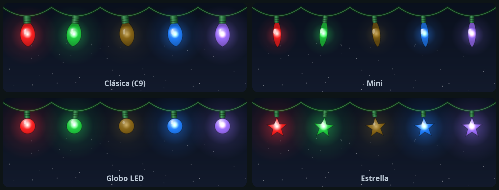
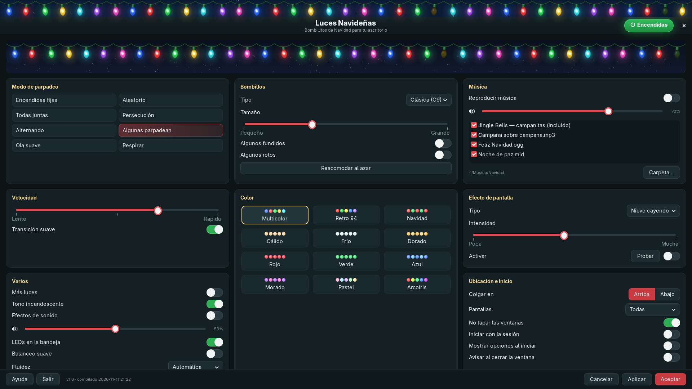

# Luces Navideñas

Bombillitos de Navidad que cuelgan del borde de la pantalla, inspirados en el clásico
«Holiday Lights» de Windows 95/98, con interfaz y luces modernas. Para **Linux (Wayland)** y **Windows**.

- Las luces no capturan el ratón: se hace clic «a través» de ellas.
- 8 modos de parpadeo, 4 tipos de bombillo, 12 paletas, nieve / ventisca / copos / destellos,
  música (villancico incluido o tu carpeta: MIDI, MP3, OGG…), icono en la bandeja con LEDs.
- Gasta muy poco: solo redibuja lo que cambia y duerme cuando nada se mueve.


| | |
|---|---|
|  |  |





## Uso

```
luces-navidenas              inicia (o abre las opciones si ya está corriendo)
luces-navidenas --opciones   abre la ventana de opciones
luces-navidenas --oculto     inicia sin mostrar la ventana de opciones
luces-navidenas --alternar   enciende / apaga las luces (útil para un atajo)
luces-navidenas --salir      cierra el programa
```

En Windows son las mismas opciones con `LucesNavidenas.exe` (el menú Inicio trae «Encender o apagar las luces»).

| | Linux | Windows |
|---|---|---|
| Configuración | `~/.config/luces-navidenas/config.json` | `%APPDATA%\LucesNavidenas\config.json` |
| Sonidos generados | `~/.cache/luces-navidenas/` | `%LOCALAPPDATA%\LucesNavidenas\cache\` |
| Registro de errores | (salida estándar) | `%LOCALAPPDATA%\LucesNavidenas\registro.txt` |

## Desarrollo

```
make test      # pruebas (sin ventanas ni sonido; las fugas de recursos cuentan como error)
make lint      # ruff, con las reglas y sus motivos en pyproject.toml
make paquete   # lint + pruebas + paquete de Arch (makepkg)
```

- `nucleo.py`: todo lo compartido (lógica, dibujo, motores de la tira y de la nieve, sonidos).
- `luces-navidenas`: la versión de Linux (GTK 3 + gtk-layer-shell).
- `windows/`: la versión de Windows (ventanas por capas de Win32, Tkinter, pystray) y su instalador.
  La compila y la prueba en un Windows real el flujo de GitHub Actions `Windows`
  (`windows/build.py` hace lo mismo a mano en Windows).

Cómo está organizado por dentro y por qué: [docs/ARQUITECTURA.md](docs/ARQUITECTURA.md).

## Instalar

Todo está en [Releases](https://github.com/1985a/luces-navidenas/releases).

**Windows 10/11:** descarga `LucesNavidenas-<versión>-Instalador.exe` y ábrelo. Se instala solo para tu
usuario (no pide permisos de administrador) y reemplaza una versión anterior conservando tus ajustes.
Como el instalador no está firmado, Windows SmartScreen puede avisar: «Más información» → «Ejecutar de todas formas».

**Arch Linux:**

```
sudo pacman -U luces-navidenas-<versión>-any.pkg.tar.xz
```

**Otras distribuciones Linux:** instala Python 3, PyGObject, pycairo, GTK 3 y gtk-layer-shell, y copia
`luces-navidenas` y `nucleo.py` a una misma carpeta (el script busca el núcleo a su lado).
Solo funciona en Wayland con wlr-layer-shell: Sway, Hyprland, river, KDE Plasma…

## Licencia

GPL-3.0-or-later. Ver [LICENSE](LICENSE).
